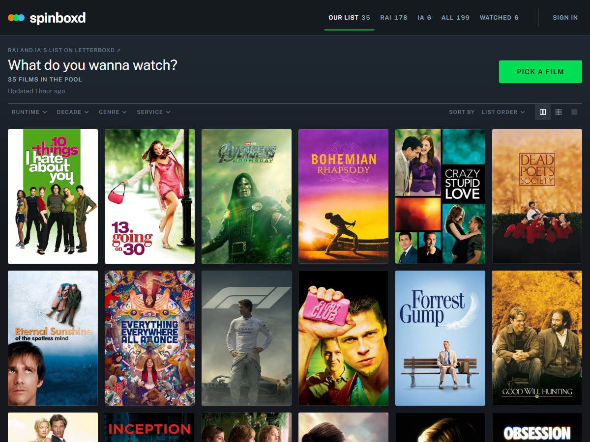

# spinboxd



Rai & Ia's watchlist. The "what do you wanna watch" / "idk, ikaw bahala" machine: pulls our Letterboxd lists and picks a film for movie night. A Python scraper turns the lists into `site/data/watchlist.json`, and a static page spins a poster reel over it.

Letterboxd has no API and blocks cloud IPs, so the scrape runs once a day in a GitHub Action instead of on every page load.

## What it does

- Tabs for each list, everything merged, and the films you've watched.
- Filter by runtime, decade, genre or streaming service, sort the grid, and switch between large, small and list views. Filters also shape the pick.
- Pick a film (or press Space): a poster reel spins and lands on a card with the synopsis, runtime, TMDB rating, where to stream it in PH, and a share link.
- Signed in, either of us can skip a film for now or mark it watched, with an undo. Both phones see it right away. The Watched tab shows the day you watched each one, and you can change it.

## Run it

```
python -m venv .venv
.venv\Scripts\pip install -r requirements-dev.txt
.venv\Scripts\python -m scraper
.venv\Scripts\python -m http.server -d site
```

Then open http://localhost:8000. `pytest` runs the scraper tests, `node --test "tests/js/*.test.mjs"` the site's.

Posters, runtime, genres, synopsis, rating and PH streaming availability come from TMDB (streaming data is from JustWatch). Streaming data is refreshed on every run; the rest is cached. Set `TMDB_API_KEY` (a free v3 key or read token) before scraping. Without it the scraper only uses what's already in `data/tmdb_cache.json`, and films without a match show a text poster.

Flags: `--source rai` refreshes one list, `--no-tmdb` skips the API.

## Lists

Edit `config.toml`. Any `/<user>/watchlist/` or `/<user>/list/<slug>/` URL works. The first source is the default pick pool.

## Deploying

1. Repo settings, Pages, source: GitHub Actions.
2. Add the `TMDB_API_KEY` secret.
3. Run the `update` workflow once by hand. After that it runs daily and commits only when the lists changed.

If a list fails to scrape, the last good data stays and the site says so. If GitHub's IPs get blocked, run the scraper from your own machine and push the JSON.

GitHub pauses scheduled workflows after 60 days without repo activity. Re-enable it from the Actions tab.

## Sign-in, skips and watched

Skips and watched films live in Firestore (`skips` and `watched` collections, one doc per Letterboxd slug). Anyone can read them; only the two owners can write, after signing in with Google. The public web config is in `site/js/firebase-config.js`. The rules are what keep it locked down.

`firestore.rules` has placeholder emails because the repo is public. Paste it into the Firebase console (Firestore, Rules), swap in the real addresses, and publish. Changing a watched date needs the `allow update` rule under `match /watched/{slug}`.

Without Firebase the site still works read-only from the last cached state.

## Wrong poster

Add the film's slug and TMDB id to `data/tmdb_overrides.toml`.
